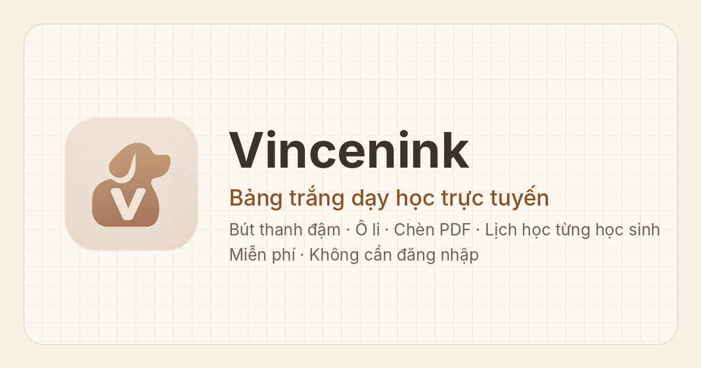

# Vincenink — Bảng trắng dạy học trực tuyến



Bảng trắng miễn phí dành cho giáo viên và gia sư, tông màu be dịu mắt, có chế độ tối. Viết như trên giấy, đưa phiếu bài tập lên bảng, và giữ bài giảng, tài liệu, lịch học, ghi chú riêng cho từng học sinh.

**Không cần đăng nhập, không cần máy chủ, không cần build.** Mọi dữ liệu nằm trong trình duyệt của bạn.

🌐 Bản chạy trực tuyến: https://qvinh-softw87.github.io/Vincenink/ (sau khi bật GitHub Pages)

## Tính năng

**Viết và vẽ**
- **Bút thanh đậm**: viết chậm thì nét đậm, viết nhanh thì nét thanh; với Apple Pencil/bút cảm ứng thì theo lực nhấn. Có thể chuyển sang nét đều.
- **Nhiều màu**: 8 màu có sẵn, bảng chọn màu tuỳ ý, bút dạ quang trong suốt.
- **Con trỏ hình bút**: khi viết, con trỏ chuột là cây bút với ngòi mang đúng màu đang chọn.
- **Bút mặc định**: nét đều, cỡ vừa. Mực đen trên nền sáng, hiện trắng trên nền tối.
- **Tẩy**: tẩy từng phần hoặc tẩy cả nét. Tẩy không xoá ảnh/PDF.
- **Khoanh vùng**:
  - *Khoanh để chọn*: di chuyển, phóng to/thu nhỏ, nhân bản, đổi màu.
  - *Khoanh để xoá*: xoá mọi thứ nằm trong vòng khoanh.
- **Hình, chữ, laser**: thêm hình và chữ lên bảng; bút laser để chỉ, nét tự mờ.
- **Nền bảng**: trơn, ô vuông, **ô li** như vở học sinh, dòng kẻ, chấm.

**Tài liệu**
- **Chèn ảnh và PDF**: mỗi trang PDF thành một ảnh để viết đè lên.
- **Chế độ bản quét**: làm trắng nền giấy và làm đậm chữ, hợp với ảnh chụp vở hay PDF scan.
- **Chụp bằng camera**: chụp tài liệu ngay từ điện thoại/iPad, ảnh được làm rõ tự động.
- **Xuất PNG và PDF**:
  - PDF *màu* hoặc PDF *bản quét* (đen trắng, nền trắng, nhẹ, in rõ).
  - Chọn khổ A4 dọc hoặc ngang; chia nhiều trang hoặc gộp vừa 1 trang.
  - Có thể kèm tiêu đề: tên bảng, học sinh, ngày, giáo viên.

**Quản lý học sinh**
- **Mục riêng từng học sinh** gồm 4 thẻ:
  - **Bảng**: bảng theo ngày.
  - **Tài liệu**: tệp của học sinh, đưa lên bảng được.
  - **Lịch**: lịch học của học sinh.
  - **Ghi chú**: tiến độ, bài về nhà.
- **Lịch học**:
  - Nút **Ghi lịch học** rõ ràng; chọn *Cố định hằng tuần* (luôn lặp lại) hoặc *Chỉ một buổi*.
  - **Đổi lịch chỉ tuần này**: dời giờ/ngày của một buổi cố định trong riêng một tuần, các tuần khác vẫn giữ nguyên.
  - *Ghi chú cho từng tuần*.
  - Đánh dấu *nghỉ buổi này*, mở nhanh bảng của buổi học, nhắc *buổi tới*.
  - Mục *Lớp chung* gộp lịch của tất cả học sinh.
- **Hồ sơ giáo viên** (góc phải thanh trên): ảnh đại diện, họ tên, vai trò, trường, liên hệ, giới thiệu. Chưa cần đăng nhập.

**Giao diện**
- **Tiếng Việt / English**. Bộ chọn **chế độ màu** có thẻ xem trước (ở thanh trên và góc dưới thanh bên): *Theo hệ thống* (luôn là mặc định mỗi lần vào trang), *Sáng (be)*, *Tối*, *Bảng phấn xanh*.
- **Bút mặc định**: nét đều, cỡ vừa, mực đen; ở nền tối/bảng phấn tự hiện màu trắng.
- **Trang giới thiệu** hiện mỗi lần vào trang.
- Tiêu đề tab thay đổi theo bảng đang dạy.
- **Kéo mép** thanh bên và cột học sinh để đổi độ rộng; kéo hẹp hẳn thì thanh bên thu thành dải biểu tượng; nhấp đúp mép để về mặc định.
- Tự động lưu, hoàn tác/làm lại, thu phóng, kéo bảng vô hạn, chụm 2 ngón, chế độ *chỉ viết bằng bút* cho iPad.
- Sao lưu và khôi phục bằng tệp JSON.

## Chạy trên máy

```bash
git clone https://github.com/qVinh-softw87/Vincenink.git
cd Vincenink
python3 -m http.server 8080     # rồi mở http://localhost:8080
```

Hoặc nhấp đúp `index.html`, hoặc trên macOS nhấp đúp `Mo-Vincenink.command`.

> Dữ liệu lưu trong **IndexedDB** của trình duyệt, gắn với từng địa chỉ (origin).
> Hãy dùng cố định một địa chỉ và thỉnh thoảng vào **Cài đặt → Tải bản sao lưu**.

## Đưa lên mạng bằng GitHub Pages

1. Vào repo → **Settings → Pages**.
2. *Source*: **Deploy from a branch**, nhánh `main`, thư mục `/ (root)` → **Save**.
3. Sau 1–2 phút, trang có tại `https://qvinh-softw87.github.io/Vincenink/`.

## SEO — để Google tìm thấy

Trang đã có sẵn:
- **Thẻ meta**: `title` và `description` tối ưu, `canonical`, Open Graph và Twitter Card (ảnh xem trước 1200×630).
- **Dữ liệu có cấu trúc JSON-LD**: `WebSite`, `WebApplication` (EducationalApplication) và `FAQPage`.
- **Tệp cho công cụ tìm kiếm**: `robots.txt`, `sitemap.xml`, `manifest.webmanifest`, bộ favicon và apple-touch-icon.
- **Trang giới thiệu** có nội dung thật (tính năng, câu hỏi thường gặp) bằng tiếng Việt và tiếng Anh để Google đọc được.

Các bước còn lại bạn cần tự làm:
1. Bật GitHub Pages như trên.
2. Vào [Google Search Console](https://search.google.com/search-console), thêm trang `https://qvinh-softw87.github.io/Vincenink/`. Xác minh bằng thẻ meta: dán mã vào chỗ đã chừa sẵn trong `<head>` của `index.html`.
3. Gửi sitemap: `https://qvinh-softw87.github.io/Vincenink/sitemap.xml`.
4. Chia sẻ link lên Facebook, các nhóm giáo viên và gia sư, diễn đàn. Liên kết từ bên ngoài là yếu tố lớn nhất giúp lên thứ hạng.

> Nếu sau này dùng tên miền riêng, hãy thay `https://qvinh-softw87.github.io/Vincenink/` trong `index.html`, `robots.txt` và `sitemap.xml`.

## Phím tắt

| Phím | Chức năng |
|---|---|
| `P` `M` `E` | Bút · Dạ quang · Tẩy |
| `L` `S` `T` `K` `H` | Khoanh vùng · Hình · Chữ · Laser · Kéo bảng |
| `Space` + kéo | Di chuyển bảng |
| `Ctrl` + cuộn | Phóng to / thu nhỏ |
| `[` `]` | Giảm / tăng độ dày |
| `1` … `8` | Chọn nhanh màu |
| `Ctrl Z` / `Ctrl Shift Z` | Hoàn tác / Làm lại |
| `Delete` · `Ctrl D` | Xoá / nhân bản vùng chọn |
| `I` | Chèn ảnh / PDF / bản quét |
| `F` | Ẩn / hiện thanh bên |

## Cấu trúc

```
index.html              giao diện + thẻ SEO + JSON-LD + trang giới thiệu
styles.css              màu sắc (sáng/tối) và bố cục
app.js                  toàn bộ chức năng: canvas, IndexedDB, lịch học, xuất PDF, đa ngôn ngữ
assets/                 logo, favicon, icon ứng dụng, ảnh chia sẻ (og-image)
favicon.ico             biểu tượng tab
manifest.webmanifest    thông tin ứng dụng web (cài lên màn hình chính)
robots.txt, sitemap.xml cho công cụ tìm kiếm
vendor/                 pdf.js 3.11.174 (Apache-2.0) để đọc PDF không cần mạng
Mo-Vincenink.command    mở nhanh trên macOS
HUONG-DAN.md            hướng dẫn sử dụng chi tiết
```

## Công nghệ

HTML, CSS và JavaScript thuần, không dùng framework:
- Vẽ bằng Canvas 2D.
- Lưu dữ liệu bằng IndexedDB.
- Đọc PDF bằng [pdf.js](https://github.com/mozilla/pdf.js).
- Xuất PDF bằng trình tạo PDF tự viết, không cần thư viện ngoài.
